
 

<picture>
  <source media="(prefers-color-scheme: dark)" srcset="https://mmr45-profil.vercel.app/img/hero.svg?mode=dark&amp;v=4&amp;lang=en" />
  
</picture>

  <picture>
    <source media="(prefers-color-scheme: dark)" srcset="https://mmr45-profil.vercel.app/terminal.svg?theme=dark&amp;v=4&amp;lang=en" />
    
  </picture>

  <a href="https://mmr45-profil.vercel.app/dashboard">
    <picture>
      <source media="(prefers-color-scheme: dark)" srcset="https://mmr45-profil.vercel.app/vues.svg?theme=dark&amp;v=4&amp;lang=en" />
      
    </picture>
  </a>

<b>🎨 Change the profile theme</b>: click here to open the menu (12 themes, including an automatic one)

 

  <a href="https://mmr45-profil.vercel.app/theme/auto"></a>
  <a href="https://mmr45-profil.vercel.app/theme/chantier"></a>
  <a href="https://mmr45-profil.vercel.app/theme/neon"></a>
  <a href="https://mmr45-profil.vercel.app/theme/ocean"></a>
  <a href="https://mmr45-profil.vercel.app/theme/matrix"></a>
  <a href="https://mmr45-profil.vercel.app/theme/sunset"></a>
  <a href="https://mmr45-profil.vercel.app/theme/nord"></a>
  <a href="https://mmr45-profil.vercel.app/theme/or"></a>
  <a href="https://mmr45-profil.vercel.app/theme/sakura"></a>
  <a href="https://mmr45-profil.vercel.app/theme/cyber"></a>
  <a href="https://mmr45-profil.vercel.app/theme/foret"></a>
  <a href="https://mmr45-profil.vercel.app/theme/lavande"></a>

One click changes the colours of the whole profile, for everyone. “Auto” follows the time and season: sakura in spring, ocean in summer, forest in autumn, nord in winter, sunset in the evening and neon at night. Reload the page to see the result.

 

<picture>
  <source media="(prefers-color-scheme: dark)" srcset="https://mmr45-profil.vercel.app/img/titre-01.svg?mode=dark&amp;v=4&amp;lang=en" />
  
</picture>

  <a href="https://batipro-ten.vercel.app"><picture>
  <source media="(prefers-color-scheme: dark)" srcset="https://mmr45-profil.vercel.app/img/projet-batipro.svg?mode=dark&amp;v=4&amp;lang=en" />
  
</picture></a>

 

  <a href="https://my-watt-up.vercel.app"><picture>
  <source media="(prefers-color-scheme: dark)" srcset="https://mmr45-profil.vercel.app/img/projet-mywattup.svg?mode=dark&amp;v=4&amp;lang=en" />
  
</picture></a>

 

  <picture>
    <source media="(prefers-color-scheme: dark)" srcset="https://mmr45-profil.vercel.app/live.svg?theme=dark&amp;v=4&amp;lang=en" />
    
  </picture>

  <picture>
    <source media="(prefers-color-scheme: dark)" srcset="https://mmr45-profil.vercel.app/img/feuille.svg?mode=dark&amp;v=1&amp;lang=en" />
    
  </picture>

 

<picture>
  <source media="(prefers-color-scheme: dark)" srcset="https://mmr45-profil.vercel.app/img/titre-02.svg?mode=dark&amp;v=4&amp;lang=en" />
  
</picture>

  <picture>
  <source media="(prefers-color-scheme: dark)" srcset="https://mmr45-profil.vercel.app/img/archi.svg?mode=dark&amp;v=4&amp;lang=en" />
  
</picture>

  <picture>
    <source media="(prefers-color-scheme: dark)" srcset="https://skillicons.dev/icons?i=ts%2Cjs%2Cvue%2Ctailwind%2Chtml%2Ccss%2Cnodejs%2Csupabase%2Cpostgres%2Cvercel%2Cgit%2Cgithub&amp;perline=12&amp;theme=dark" />
    
  </picture>

 

<picture>
  <source media="(prefers-color-scheme: dark)" srcset="https://mmr45-profil.vercel.app/img/titre-03.svg?mode=dark&amp;v=4&amp;lang=en" />
  
</picture>

  <picture>
  <source media="(prefers-color-scheme: dark)" srcset="https://mmr45-profil.vercel.app/img/parcours.svg?mode=dark&amp;v=4&amp;lang=en" />
  
</picture>

 

<picture>
  <source media="(prefers-color-scheme: dark)" srcset="https://mmr45-profil.vercel.app/img/titre-04.svg?mode=dark&amp;v=4&amp;lang=en" />
  
</picture>

  <picture>
    <source media="(prefers-color-scheme: dark)" srcset="https://mmr45-profil.vercel.app/img/stats.svg?mode=dark&amp;v=5&amp;lang=en" />
    
  </picture>

  <picture>
    <source media="(prefers-color-scheme: dark)" srcset="https://mmr45-profil.vercel.app/img/ville.svg?mode=dark&amp;v=5&amp;lang=en" />
    
  </picture>

  <picture>
    <source media="(prefers-color-scheme: dark)" srcset="https://mmr45-profil.vercel.app/img/rouleau.svg?mode=dark&amp;v=1&amp;lang=en" />
    
  </picture>

  <picture>
    <source media="(prefers-color-scheme: dark)" srcset="https://mmr45-profil.vercel.app/img/succes.svg?mode=dark&amp;v=1&amp;lang=en" />
    
  </picture>

 

<picture>
  <source media="(prefers-color-scheme: dark)" srcset="https://mmr45-profil.vercel.app/img/titre-05.svg?mode=dark&amp;v=4&amp;lang=en" />
  
</picture>

  <picture>
    <source media="(prefers-color-scheme: dark)" srcset="https://mmr45-profil.vercel.app/reactions.svg?theme=dark&amp;v=4&amp;lang=en" />
    
  </picture>

  <a href="https://mmr45-profil.vercel.app/reagir/feu"><picture><source media="(prefers-color-scheme: dark)" srcset="https://mmr45-profil.vercel.app/img/reaction-feu.svg?mode=dark&amp;v=4&amp;lang=en" /></picture></a>
  <a href="https://mmr45-profil.vercel.app/reagir/bravo"><picture><source media="(prefers-color-scheme: dark)" srcset="https://mmr45-profil.vercel.app/img/reaction-bravo.svg?mode=dark&amp;v=4&amp;lang=en" /></picture></a>
  <a href="https://mmr45-profil.vercel.app/reagir/wow"><picture><source media="(prefers-color-scheme: dark)" srcset="https://mmr45-profil.vercel.app/img/reaction-wow.svg?mode=dark&amp;v=4&amp;lang=en" /></picture></a>
  <a href="https://mmr45-profil.vercel.app/reagir/idee"><picture><source media="(prefers-color-scheme: dark)" srcset="https://mmr45-profil.vercel.app/img/reaction-idee.svg?mode=dark&amp;v=4&amp;lang=en" /></picture></a>
  <a href="https://mmr45-profil.vercel.app/reagir/peinture"><picture><source media="(prefers-color-scheme: dark)" srcset="https://mmr45-profil.vercel.app/img/reaction-peinture.svg?mode=dark&amp;v=4&amp;lang=en" /></picture></a>

 

 
 
 
 
 

  <b>The mural: click a square, pick your colour.</b> Or click a paint can to paint a random square. No account, everything updates live.

  
  
  
  
  <a href="https://mmr45-profil.vercel.app/peindre/rose"></a>
  
  

 

<picture>
  <source media="(prefers-color-scheme: dark)" srcset="https://mmr45-profil.vercel.app/img/titre-06.svg?mode=dark&amp;v=4&amp;lang=en" />
  
</picture>

  Feedback on a project, a question about building work or code: write to me, I reply.

  
  
  

 

<picture>
  <source media="(prefers-color-scheme: dark)" srcset="https://mmr45-profil.vercel.app/img/pied.svg?mode=dark&amp;v=4&amp;lang=en" />
  
</picture>

