<picture>
  <source media="(prefers-color-scheme: dark)" srcset="https://mmr45-profil.vercel.app/img/hero.svg?mode=dark&amp;v=2" />
  
</picture>

  <picture>
    <source media="(prefers-color-scheme: dark)" srcset="https://mmr45-profil.vercel.app/terminal.svg?theme=dark" />
    
  </picture>

  <a href="https://mmr45-profil.vercel.app/dashboard">
    <picture>
      <source media="(prefers-color-scheme: dark)" srcset="https://mmr45-profil.vercel.app/vues.svg?theme=dark" />
      
    </picture>
  </a>

<b>🎨 Changer le thème du profil</b> : clique ici pour ouvrir le menu (11 thèmes)

 

  
  
  
  
  
  
  
  
  
  
  

Un clic change les couleurs de tout le profil, pour tout le monde. Recharge la page pour voir le résultat.

 

<picture>
  <source media="(prefers-color-scheme: dark)" srcset="https://mmr45-profil.vercel.app/img/titre-01.svg?mode=dark&amp;v=2" />
  
</picture>

  <a href="https://batipro-ten.vercel.app"><picture>
  <source media="(prefers-color-scheme: dark)" srcset="https://mmr45-profil.vercel.app/img/projet-batipro.svg?mode=dark&amp;v=3" />
  
</picture></a>

 

  <a href="https://my-watt-up.vercel.app"><picture>
  <source media="(prefers-color-scheme: dark)" srcset="https://mmr45-profil.vercel.app/img/projet-mywattup.svg?mode=dark&amp;v=3" />
  
</picture></a>

 

  <picture>
    <source media="(prefers-color-scheme: dark)" srcset="https://mmr45-profil.vercel.app/live.svg?theme=dark" />
    
  </picture>

 

<picture>
  <source media="(prefers-color-scheme: dark)" srcset="https://mmr45-profil.vercel.app/img/titre-02.svg?mode=dark&amp;v=2" />
  
</picture>

  <picture>
  <source media="(prefers-color-scheme: dark)" srcset="https://mmr45-profil.vercel.app/img/archi.svg?mode=dark&amp;v=2" />
  
</picture>

  <picture>
    <source media="(prefers-color-scheme: dark)" srcset="https://skillicons.dev/icons?i=ts%2Cjs%2Cvue%2Ctailwind%2Chtml%2Ccss%2Cnodejs%2Csupabase%2Cpostgres%2Cvercel%2Cgit%2Cgithub&amp;perline=12&amp;theme=dark" />
    
  </picture>

 

<picture>
  <source media="(prefers-color-scheme: dark)" srcset="https://mmr45-profil.vercel.app/img/titre-03.svg?mode=dark&amp;v=2" />
  
</picture>

  <picture>
  <source media="(prefers-color-scheme: dark)" srcset="https://mmr45-profil.vercel.app/img/parcours.svg?mode=dark&amp;v=2" />
  
</picture>

 

<picture>
  <source media="(prefers-color-scheme: dark)" srcset="https://mmr45-profil.vercel.app/img/titre-04.svg?mode=dark&amp;v=2" />
  
</picture>

  <picture>
    <source media="(prefers-color-scheme: dark)" srcset="https://raw.githubusercontent.com/mmr45/mmr45/stats/activite-dark.svg" />
    
  </picture>

  <picture>
    <source media="(prefers-color-scheme: dark)" srcset="https://raw.githubusercontent.com/mmr45/mmr45/output/github-contribution-grid-snake-dark.svg" />
    
  </picture>

 

<picture>
  <source media="(prefers-color-scheme: dark)" srcset="https://mmr45-profil.vercel.app/img/titre-05.svg?mode=dark&amp;v=2" />
  
</picture>

  <picture>
    <source media="(prefers-color-scheme: dark)" srcset="https://mmr45-profil.vercel.app/reactions.svg?theme=dark" />
    
  </picture>

  <a href="https://mmr45-profil.vercel.app/reagir/feu"><picture><source media="(prefers-color-scheme: dark)" srcset="https://mmr45-profil.vercel.app/img/reaction-feu.svg?mode=dark&amp;v=3" /></picture></a>
  <a href="https://mmr45-profil.vercel.app/reagir/bravo"><picture><source media="(prefers-color-scheme: dark)" srcset="https://mmr45-profil.vercel.app/img/reaction-bravo.svg?mode=dark&amp;v=3" /></picture></a>
  <a href="https://mmr45-profil.vercel.app/reagir/wow"><picture><source media="(prefers-color-scheme: dark)" srcset="https://mmr45-profil.vercel.app/img/reaction-wow.svg?mode=dark&amp;v=3" /></picture></a>
  <a href="https://mmr45-profil.vercel.app/reagir/idee"><picture><source media="(prefers-color-scheme: dark)" srcset="https://mmr45-profil.vercel.app/img/reaction-idee.svg?mode=dark&amp;v=3" /></picture></a>
  <a href="https://mmr45-profil.vercel.app/reagir/peinture"><picture><source media="(prefers-color-scheme: dark)" srcset="https://mmr45-profil.vercel.app/img/reaction-peinture.svg?mode=dark&amp;v=3" /></picture></a>

 

  <picture>
    <source media="(prefers-color-scheme: dark)" srcset="https://mmr45-profil.vercel.app/mur.svg?theme=dark" />
    
  </picture>

  <b>Un clic sur un pot = une case peinte.</b> Pas de compte, pas de formulaire : le mur se met à jour en direct.

  
  
  
  
  
  
  

 

<picture>
  <source media="(prefers-color-scheme: dark)" srcset="https://mmr45-profil.vercel.app/img/titre-06.svg?mode=dark&amp;v=2" />
  
</picture>

  Un retour sur un projet, une question sur le bâtiment ou sur le code : écris-moi, je réponds.

  
  
  

 

<picture>
  <source media="(prefers-color-scheme: dark)" srcset="https://mmr45-profil.vercel.app/img/pied.svg?mode=dark&amp;v=2" />
  
</picture>

