  <picture>
    <source media="(prefers-color-scheme: dark)" srcset="./assets/header-dark.svg" />
    
  </picture>

  
  
  
  
  

 

<picture>
  <source media="(prefers-color-scheme: dark)" srcset="./assets/s-projets-dark.svg" />
  
</picture>

  <a href="https://batipro-ten.vercel.app"><picture>
    <source media="(prefers-color-scheme: dark)" srcset="./assets/batipro-dark.svg" />
    
  </picture></a>
  <a href="https://my-watt-up.vercel.app"><picture>
    <source media="(prefers-color-scheme: dark)" srcset="./assets/mywattup-dark.svg" />
    
  </picture></a>

 

<picture>
  <source media="(prefers-color-scheme: dark)" srcset="./assets/s-outils-dark.svg" />
  
</picture>

  <picture>
    <source media="(prefers-color-scheme: dark)" srcset="https://skillicons.dev/icons?i=js%2Cts%2Chtml%2Ccss%2Ctailwind%2Cvue%2Cnodejs%2Csupabase%2Cpostgres%2Cvercel%2Cgit%2Cgithub%2Cjava%2Clua&perline=14&theme=dark" />
    
  </picture>

  
  
  
  

 

<picture>
  <source media="(prefers-color-scheme: dark)" srcset="./assets/s-parcours-dark.svg" />
  
</picture>

  <picture>
    <source media="(prefers-color-scheme: dark)" srcset="./assets/parcours-dark.svg" />
    
  </picture>

 

<picture>
  <source media="(prefers-color-scheme: dark)" srcset="./assets/s-activite-dark.svg" />
  
</picture>

  <picture>
    <source media="(prefers-color-scheme: dark)" srcset="https://mmr45.vercel.app/api?username=mmr45&show_icons=true&hide_border=true&border_radius=16&locale=fr&count_private=true&include_all_commits=true&custom_title=Activit%C3%A9%20GitHub&hide_rank=true&card_width=420&bg_color=111A2E&title_color=FF6A13&text_color=C9D4E5&icon_color=4A92FF" />
    
  </picture>
  <picture>
    <source media="(prefers-color-scheme: dark)" srcset="https://mmr45.vercel.app/api/top-langs/?username=mmr45&layout=compact&hide_border=true&border_radius=16&locale=fr&langs_count=6&card_width=360&custom_title=Langages&bg_color=111A2E&title_color=FF6A13&text_color=C9D4E5&icon_color=4A92FF" />
    
  </picture>

  <picture>
    <source media="(prefers-color-scheme: dark)" srcset="https://github-readme-streak-stats-eight.vercel.app/?user=mmr45&hide_border=true&border_radius=16&locale=fr&background=111A2E&ring=FF6A13&fire=FF6A13&currStreakNum=EEF3FA&sideNums=EEF3FA&currStreakLabel=FF6A13&sideLabels=8A9BB8&dates=5C6E8F&stroke=22304D" />
    
  </picture>

  <picture>
    <source media="(prefers-color-scheme: dark)" srcset="https://raw.githubusercontent.com/mmr45/mmr45/output/github-contribution-grid-snake-dark.svg" />
    
  </picture>

 

<picture>
  <source media="(prefers-color-scheme: dark)" srcset="./assets/s-contact-dark.svg" />
  
</picture>

Un retour sur mes projets, une question sur le bâtiment ou sur le code : écris-moi, je réponds.

  
  
  
  
  

  <picture>
    <source media="(prefers-color-scheme: dark)" srcset="./assets/footer-dark.svg" />
    
  </picture>

